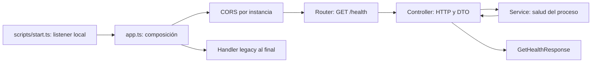

# BE-06 — Implementación local de arquitectura por capas

**Fecha:** 16/11/2026, America/Buenos_Aires. **Estado:** implementada y validada localmente; pendiente de revisión e integración, no Done. Preview Vercel de BE-05 sigue pendiente y, por autorización expresa del pedido BE-06, no bloquea este desarrollo local. No se inició BE-07.

## 1. Preparación, fuentes y protección del trabajo previo

- Rama creada: `feature/be-06-arquitectura-capas`, desde `feature/be-05-preparacion-typescript`, base `e2c19c38cf2ad8f40c98aaff5d8248a561ccb474`. Fetch de origin satisfactorio; la referencia remota BE-05 y HEAD coincidían con ese SHA y con el PR #5 Draft hacia dev.
- Identidad local: Camila Gonzalez / `camiiigonzalez1503@gmail.com`; usuario configurado para HTTPS `camiegonzalez`. El conector GitHub confirmó la cuenta `camiegonzalez`; origin corresponde a `Proyecto-Agro-Org/be-agro`. No se cambiaron identidades ni credenciales.
- No había cambios tracked ni staged. Existía un único untracked previo: `INFORME_BE05_VERCEL_DEPLOYMENT.md`. Se copió y verificó antes del fetch/cambio de rama; el original permaneció en el árbol, sin editarlo. Por tanto, el árbol completo no estaba inicialmente limpio: la excepción conocida quedó protegida, no descartada ni incorporada a BE-06.
- Respaldo fuera del repositorio: `C:\Users\CAMILA~1\AppData\Local\Temp\agro-be06-respaldo-0af498e2ef8c4dbfb17150dde9bbfb72\INFORME_BE05_VERCEL_DEPLOYMENT.md`. SHA-256 de original y respaldo: `6445DC2925627E49F9C8EEE03BAD3DF67362761DC155DD4E9DF422A6280A5E5D`. Es protección local temporal, no un respaldo permanente remoto.
- Leídos: AGENTS.md, IMPLEMENTATION_PLAN.md, ESPECIFICACION.md, DEFINITION_OF_DONE.md, README, informes de implementación/auditoría BE-05, código, tests y configuración TS. Sus estados históricos no se convierten en afirmaciones actuales: la migración ya está publicada, pero continúa sin integrar.
- Consultados en lectura los PR #2/#3/#4 y #5. Los tres primeros permanecen Draft; sus decisiones propuestas y evidencia Atlas pendiente no se consideran aprobaciones. La consulta de Issues no devolvió un Issue BE-06/capas independiente; se aplicó el alcance del pedido y los criterios del plan. No se modificó ningún PR.

## 2. Arquitectura anterior y resultado

Antes, `src/app.ts` concentraba composición Express, parseo de CORS_ORIGINS, política CORS, handler HTTP health y errores. `scripts/start.ts` ya separaba el listener. No existían persistencia ni recursos de negocio.

Ahora `app.ts` compone módulos, conserva factory/default export y no abre puerto. Health tiene un router por instancia, controller delgado, service sin Express y DTOResponse explícito. CORS y errores se extraen sin nuevas reglas. El arranque, scripts, paquetes, configuración TypeScript y vercel.json permanecen intactos.

El diagrama muestra responsabilidades y flujo de datos; los imports siguen app → router → controller → service/DTO, sin dependencia inversa del service hacia HTTP. La persistencia futura seguirá service → repository → model cuando corresponda. Health termina en service: no necesita repository/model ni adapter externo.

## 3. Archivos y responsabilidades

| Archivo | Cambio y responsabilidad |
| --- | --- |
| `src/app.ts` | Modificado: composición, deshabilitar x-powered-by, CORS, router y handler final |
| `src/config/cors.ts` | Nuevo: parseo original de CORS_ORIGINS, coma/trim/ausencias; lectura por llamada |
| `src/middlewares/cors.middleware.ts` | Nuevo: política original exacta con ReadonlySet por instancia |
| `src/middlewares/legacy-error.middleware.ts` | Nuevo: handler de cuatro argumentos, convención statusCode y logging originales |
| `src/routes/health.routes.ts` | Nuevo: factory del router y enlace GET /health al controller |
| `src/controllers/health.controller.ts` | Nuevo: delega al service, mapea explícitamente la respuesta al DTO y emite HTTP 200 |
| `src/services/health.service.ts` | Nuevo: resultado de liveness del proceso; sin Request/Response, status HTTP o dependencias externas |
| `src/dto/health.dto.ts` | Nuevo: GetHealthResponse con status literal ok; GetHealthRequest no aplica porque no se consume entrada |
| `test/health-layers.test.js` | Nuevo: tres pruebas de módulos y propagación de errores |
| `README.md` | Actualizado: estructura y resultados BE-06; comandos sin cambios |
| `INFORME_BE06_ARQUITECTURA_CAPAS.md` | Nuevo: este informe |

No se crearon carpetas vacías `repositories`, `models`, `adapters`, `types` ni interfaces de persistencia ficticias. No hay modelos Mongoose ni mappers de documentos Mongo. El controller construye el DTO con un mapeo simple; no se añade un archivo mapper para una sola propiedad. El tipo de respuesta no valida HTTP en runtime ni prohíbe entradas extra mediante validación nueva.

## 4. Decisiones técnicas y compatibilidad

- Se respeta NodeNext/ESM con imports relativos `.js` y `import type`. TypeScript strict continúa activo. No se añaden `any`, ciclos, DI containers, clases base ni dependencias.
- El service tiene la responsabilidad acotada de liveness sin inspeccionar infraestructura; su respuesta no contiene status HTTP. No se presenta como readiness de Atlas.
- Cada createApp construye su CORS y router. No se introduce un singleton mutable de configuración; el middleware de errores compartido es una función sin estado por aplicación.
- Orden preservado: deshabilitar x-powered-by → CORS → rutas → errores. GET health conserva 200 y JSON exacto; HEAD sigue automático; POST health y rutas ajenas siguen 404 HTML.
- Coincidencia exacta de Origin, sin Origin, wildcard, 403 legacy y 500 legacy se conservan. La aserción estática heredada `error as LegacyError` no se convierte en validación runtime. Su endurecimiento y el error uniforme pertenecen a BE-08, no a esta reorganización.
- No se importa ni copia el OpenAPI de PR #3 a esta rama. El contrato externo health no cambia; el DTO coincide con el health documentado. No se modifican contratos de negocio pendientes.

## 5. Validaciones ejecutadas

| Comprobación local | Resultado |
| --- | --- |
| `npm ci --no-audit --no-fund` | Exit 0, 80 paquetes instalados desde lock; sin cambios de package/lock. Equivale a npm ci sin auditoría/funding, no a npm audit |
| `npm run typecheck` | Exit 0, sin errores |
| `npm run build` | Exit 0, módulos ESM compilados en dist |
| `npm test` | Exit 0, **21/21** aprobadas, cero fallos/skips; descubrimiento de los tres archivos |
| 18 pruebas anteriores | Archivos originales intactos y todas aprobadas |
| Tres pruebas nuevas | Service aislado/resultados independientes; router montado en otra app con prefijo, GET/HEAD y métodos negativos; error async Express 5 → handler legacy seguro y logging |
| Arranque local y health | Test real del listener compilado en proceso hijo con PORT=0: 200 y JSON exacto, sin .env real; se cierra el listener creado por la prueba |
| Comparación HTTP BE-05 → BE-06 | **13/13** escenarios equivalentes, descritos abajo |
| `git diff --check` y revisión de archivos nuevos | Sin errores de espacios; compilados y archivos locales excluidos |

La comparación diferencial leyó `src/app.ts` del SHA base mediante git show, lo transpiló en memoria con el TypeScript ya instalado y resolvió únicamente los imports express/cors a las mismas dependencias instaladas. No se modificó el contenido lógico ni el árbol histórico. Se comparó esa factory con `dist/src/app.js` modular en listeners efímeros locales separados.

Se verificaron exactamente status, cuerpo y headers contractuales: Content-Type, Access-Control-Allow-Origin/Methods/Headers/Credentials, Vary y x-powered-by. Se excluyeron headers volátiles, como Date. Los escenarios fueron: GET health sin Origin, HEAD health, origen permitido, denegado, barra final, puerto explícito, sufijo de dominio, wildcard, allowlist vacía, preflight, ruta desconocida, POST health y error interno sintético con logging. No se añadieron rutas sintéticas al código productivo; el fallo se inyectó únicamente en las aplicaciones de prueba.

No se encontraron regresiones HTTP en esta superficie ni se cambiaron expectativas para ocultarlas. La comparación no prueba todos los inputs posibles ni certifica Vercel. La ausencia de Atlas se comprueba por el alcance de imports, ausencia de dependencias Mongo y tests sin conexión externa; no se afirma haber probado comportamiento de una futura base.

## 6. Riesgos, dependencias y continuidad

- BE-06 depende del commit BE-05 aún en Draft: una futura revisión debe distinguir el delta BE-06 de los cambios heredados y coordinar base/rebase solo cuando el equipo lo autorice. No se reescribió historia.
- Preview Vercel, configuración efectiva/autodeploy y posible impacto en producción permanecen pendientes según BE-05.4/05.5. No se hicieron nuevas solicitudes remotas HTTP, CLI Vercel, despliegues ni ajustes. No publicar esta rama sin revisar el riesgo de autodeploy.
- BE-02/Atlas: siguen pendientes evidencia física, BSON, IDs, lotes y correlación de dispositivos. No bloquean health/capas locales; sí condicionan modelos/repositories reales y el alcance de BE-07.
- BE-03: autenticación, contratos y transición de errores pendientes de aprobación FE/BE. No se implementaron esas propuestas.
- BE-04: unidades, normalización, precisión y calibración pendientes de responsables. No se agregaron conversiones ni DTOs de telemetría.
- Build/watch conserva la limitación documentada de JS obsoleto ante un error posterior de tipos; no se cambian scripts ni se afirma haber repetido aquí toda la auditoría watch/runtime-only de BE-05.
- Los documentos base contienen estados históricos; no se marcaron casillas Done ni se actualizaron etapas ajenas para anticipar integración.

**Para considerar continuar BE-07:** revisar el delta y su dependencia BE-05, acordar el alcance de conexión/configuración validada y los datos/modelo mínimos, definir entorno de pruebas aislado y acceso autorizado cuando aplique; ejecutar solo tras autorización específica. No asumir que health aprobado habilita MongoDB, Zod, autenticación o modelos de dominio.

**Recomendación:** BE-06 está lista localmente para auditoría/revisión del alcance incremental. Cierre pendiente de PR revisado/integrado y criterios aplicables satisfechos. Sin commit, push, PR nuevo, instalación de paquetes nuevos, frontend/IoT, Atlas ni BE-07.

## 7. Auditoría BE-06.1

La [auditoría BE-06.1](INFORME_BE06_AUDITORIA.md) repitió instalación desde lock,
typecheck, build y las 21 pruebas; confirmó 13/13 diferenciales contra el commit
BE-05 y el health de la exportación default. No detectó defectos que justificaran
cambios de código o tests adicionales. Documenta límites heredados, ausencia de
ciclos y dependencias runtime nuevas, y una descripción propuesta para PR Draft
encadenado hacia `feature/be-05-preparacion-typescript`. Ambas ramas todavía
apuntan al mismo SHA: el delta sigue sin commit. Preview Vercel y el control del
autodeploy permanecen pendientes; no se autoriza publicación desde este informe.
