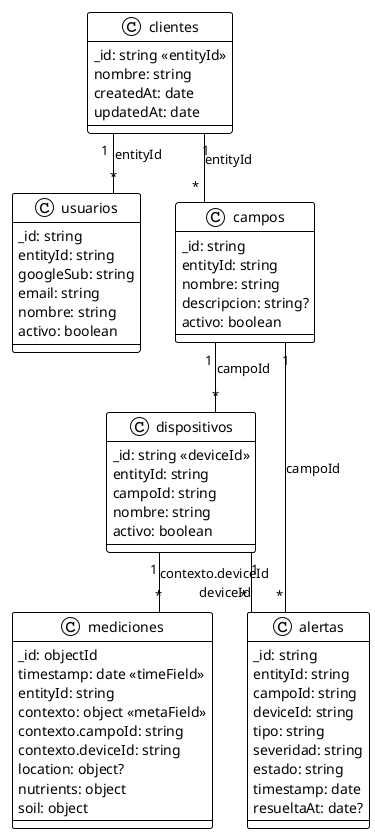

# Propuesta de esquema MongoDB para `be-agro`

**Estado:** propuesta para revisión del equipo  
**Base:** schema actual compartido + alcance de `be-agro`  
**Especificación relacionada:** [ESPECIFICACION.md](ESPECIFICACION.md)

## 1. Objetivos del esquema

El esquema debe permitir:

- Autenticar con Google y resolver a qué entidad pertenece el usuario.
- Aislar todas las lecturas por `entityId` obtenido del usuario autenticado.
- Relacionar entidad → usuarios/campos → dispositivos → mediciones.
- Servir áreas, sensores, mapa, última lectura e históricos al frontend.
- Representar alertas si siguen dentro del alcance de esta entrega.

## 2. Decisión de modelado

- La colección actual `clientes` representa la entidad/tenant del sistema. Su `_id` es el identificador de entidad.
- Cada usuario pertenece a una entidad mediante `entityId`.
- Cada campo pertenece a una entidad mediante `entityId`.
- Cada dispositivo pertenece a un campo y a la misma entidad mediante `campoId` y `entityId`.
- Cada medición pertenece a un dispositivo y campo y lleva la referencia a la misma entidad para filtrar directamente por tenant.
- En el contrato HTTP, el frontend puede seguir llamando `area_id` al campo y `device_id` al dispositivo. El backend mapea los nombres sin obligar a que coincidan con los nombres internos de Mongo.

Para evitar inventar equivalencias, el modelo lógico usa `campos`. Si los documentos de `lotes` ya representan exactamente campos, se migra esa colección a la forma objetivo (conservando el nombre físico `lotes` si no se quiere renombrar). Si “lote” y “campo” son conceptos diferentes, se mantiene `lotes` separado y se crea `campos`.

## 2.1 Diagrama objetivo



`entityId` repetido en documentos de negocio permite aislar consultas directamente. `clientes._id` identifica la entidad raíz; por eso no se agrega un `entityId` redundante a la propia entidad.

## 3. Esquema objetivo

Los tipos de IDs y referencias deben ser consistentes. Como el schema actual declara IDs de catálogo como `string`, esta propuesta mantiene strings para referencias de dominio y reserva `ObjectId` para `_id` de mediciones.

### `clientes` — entidad

```js
{
  _id: String,          // entityId estable
  nombre: String,
  createdAt: Date,
  updatedAt: Date
}
```

### `usuarios` — identidad interna vinculada con Google

```js
{
  _id: String,
  entityId: String,     // referencia a clientes._id
  googleSub: String,    // subject estable provisto por Google; no usar email como ID primario
  email: String,
  nombre: String,
  activo: Boolean,
  createdAt: Date,
  updatedAt: Date
}
```

Un usuario se asocia con una sola entidad. No se guarda contraseña de Google. Una cuenta no habilitada o sin `entityId` no accede a la API. Si se elige autoaprovisionamiento, debe definirse una regla segura para asignar la entidad; no se debe tomar `entityId` del perfil enviado por el navegador.

### `campos` — campos/áreas visibles en la aplicación

```js
{
  _id: String,
  entityId: String,     // referencia a clientes._id
  nombre: String,
  descripcion: String | null,
  activo: Boolean,
  createdAt: Date,
  updatedAt: Date
}
```

La API puede serializar `_id` como `area_id`. No añadir ubicación del campo salvo que el equipo confirme que el campo completo tiene una ubicación propia distinta de los puntos de los sensores.

### `dispositivos` — sensores/nodos registrados

```js
{
  _id: String,          // device_id público/estable
  entityId: String,     // duplicado deliberado para filtrar tenant directamente
  campoId: String,      // referencia a campos._id (o a lotes._id si se conserva esa colección)
  nombre: String,
  activo: Boolean,
  createdAt: Date,
  updatedAt: Date
}
```

El estado `conectado/desconectado`, la última comunicación, la ubicación vigente y la última medición se derivan de la medición más reciente. Evitar guardar esos mismos valores en `dispositivos` si no existe un proceso de ingesta que los mantenga sincronizados. Si se necesitan para rendimiento, definirlos como una proyección/cache y dejar claro que `mediciones` es la fuente de verdad.

### `mediciones` — colección MongoDB Time Series

```js
{
  _id: ObjectId,
  timestamp: Date,      // BSON Date; se serializa a ISO 8601 UTC en la API
  entityId: String,     // referencia a clientes._id; filtro de tenant
  contexto: {
    campoId: String,
    deviceId: String
  },
  location: {
    lat: Number,
    lon: Number
  } | null,
  nutrients: {
    nitrogen: Number | null,
    phosphorus: Number | null,
    potassium: Number | null
  },
  soil: {
    conductivity: Number | null,
    humidity: Number | null,
    temperature: Number | null
  }
}
```

Configuración propuesta de la colección:

```js
db.createCollection("mediciones", {
  timeseries: {
    timeField: "timestamp",
    metaField: "contexto",
    granularity: "minutes"
  }
})
```

`contexto` agrupa los identificadores estables del campo/dispositivo; `entityId` queda como campo directo del documento para respetar el modelo de tenant acordado; `timestamp` representa el instante de observación. `granularity` debe ajustarse a la frecuencia real confirmada de publicación. No fijar retención hasta acordar cuánto histórico se debe conservar.

La colección Time Series exige que `timeField` contenga una fecha BSON válida. MongoDB permite un `metaField` opcional para metadatos relativamente estables y documenta un índice compuesto de metadatos/tiempo para nuevas colecciones. Verificar versión de Atlas antes de fijar opciones. ([MongoDB: Create and Query a Time Series Collection](https://www.mongodb.com/docs/manual/core/timeseries/timeseries-procedures/))

### `alertas` — colección propuesta para el contrato actual

```js
{
  _id: String,
  entityId: String,
  campoId: String,
  deviceId: String,
  tipo: "tecnica" | "agronomica",
  severidad: "alta" | "media" | "baja",
  descripcion: String,
  estado: "activa" | "resuelta",
  timestamp: Date,
  resueltaAt: Date | null,
  createdAt: Date,
  updatedAt: Date
}
```

El schema actual no incluye alertas. Como el frontend consulta alertas activas y resueltas, con filtros y orden, se propone persistirlas en esta colección. Las reglas que las crean/resuelven siguen pendientes; `entityId`, `campoId` y `deviceId` deben corresponder a los recursos relacionados. Si el equipo decide derivarlas en cada consulta, deberá justificar cómo representar y consultar de forma estable su historial y resolución.

## 4. Reglas de aislamiento y consistencia

1. El `entityId` autorizado se obtiene de la sesión interna del usuario, cuya relación `usuarios.entityId` se resolvió durante login.
2. Todas las consultas de catálogo filtran por `entityId` en MongoDB, incluidas listas, detalles y agregaciones.
3. Las consultas de mediciones filtran por `entityId` y `contexto.deviceId`/`campoId` según el recurso solicitado.
4. Nunca se usa un `entityId` que venga en query, body o header público para ampliar el acceso.
5. Al crear una referencia o transformar datos, comprobar que usuario, campo, dispositivo y medición mantienen el mismo `entityId`.
6. Un recurso inexistente o fuera de la entidad autenticada responde `404`.
7. IDs y nombres de campos son sensibles a mayúsculas/minúsculas; adoptar exactamente `entityId`, `campoId`, `deviceId`, `googleSub`, `timestamp`, `contexto`, `location`, `nutrients` y `soil` o escoger una convención única antes de migrar.

## 5. Mapeo a respuestas del frontend

| Persistencia | Contrato frontend |
|---|---|
| `campos._id` | `area_id` |
| `campos.nombre` | `nombre` / `area_nombre` |
| `dispositivos._id` | `device_id` |
| `dispositivos.campoId` | `area_id` |
| `mediciones.timestamp` | `timestamp` ISO 8601 UTC |
| `mediciones.soil.humidity` | `humedad` |
| `mediciones.soil.temperature` | `temperatura` |
| `mediciones.soil.conductivity` | `conductividad` |
| `mediciones.nutrients.nitrogen` | `nitrogeno` |
| `mediciones.nutrients.phosphorus` | `fosforo` |
| `mediciones.nutrients.potassium` | `potasio` |
| `mediciones.location` | `ubicacion` |

Las unidades se fijan en el contrato de API según las decisiones del equipo; el documento actual no las contiene. Un valor ausente se transforma en `null`, nunca en cero.

## 6. Índices iniciales a evaluar

- `usuarios`: índice único por `googleSub`; índice por `entityId` para administración/consultas de usuarios.
- `campos`: índice compuesto por `entityId` y `_id` si se requiere validar/consultar ambos explícitamente.
- `dispositivos`: índice compuesto por `entityId` y `campoId` para listar dispositivos de un campo.
- `mediciones`: índice de la colección Time Series en `contexto`/`timestamp` según la configuración; evaluar índice secundario para `entityId` y validar el plan de consultas en Atlas. Las colecciones Time Series admiten índices secundarios con consideraciones y limitaciones propias. ([MongoDB: Time Series Indexes](https://www.mongodb.com/docs/manual/core/timeseries/timeseries-index/))
- `alertas`: índices según filtros aprobados, empezando por entidad/estado/fecha y entidad/campo/estado.

Los índices deben comprobarse contra versión y limitaciones de Atlas, cardinalidad y consultas reales. No intentar imponer índices únicos no soportados por la colección Time Series; la unicidad de mediciones, si hace falta, se resuelve en el productor/ingesta o con una colección de deduplicación.

## 7. Migración desde el schema actual

1. Confirmar versión de MongoDB Atlas y revisar documentos reales; `entityId` es parte del modelo acordado y se comprueba su tipo/consistencia en todas las colecciones de datos.
2. Exportar un respaldo antes de alterar documentos o colecciones.
3. Normalizar `entityId` en usuarios, campos/lotes y dispositivos (completarlo solo donde falte) y añadir `campoId` a dispositivos. Verificar cada relación antes de actualizar mediciones.
4. Transformar las mediciones para incluir `entityId`, `contexto.campoId` y `contexto.deviceId`, preservando el `device_id` original durante una fase de compatibilidad si Make o consumidores actuales lo requieren.
5. Convertir strings ISO válidos de `timestamp` a BSON Date; separar/revisar los documentos con fechas inválidas, sin descartarlos silenciosamente.
6. Crear la colección Time Series nueva con opciones aprobadas e importar/conmutar lecturas por etapas. No convertir una colección existente en el lugar sin validar restricciones/versiones y plan de rollback.
7. Crear usuarios con Google `sub` y `entityId`; no inventar cuentas o asociarlas a una entidad por email sin regla aprobada.
8. Implementar `alertas` solo cuando su origen y reglas estén acordadas.
9. Validar conteos, relaciones y consultas por entidad; documentar rollback y retirar compatibilidad antigua cuando todos los consumidores migren.

## 8. Pendientes para aceptar esta propuesta

- Confirmar si `lotes` son los campos del modelo. Si sí, decidir mantener el nombre físico `lotes` o renombrar a `campos`; no duplicar ambos por defecto.
- Acordar tipos BSON reales para `entityId`, `campoId` y `deviceId`; esta propuesta usa string para ser consistente con el schema actual.
- Acordar formato y frecuencia real de `timestamp` antes de elegir `granularity`.
- Acordar unidades y política de mediciones parciales.
- Acordar si alertas se persisten o se calculan y si forman parte del alcance.
- Acordar allowlist/alta de cuentas Google y proceso para asignar `entityId` a usuarios.
